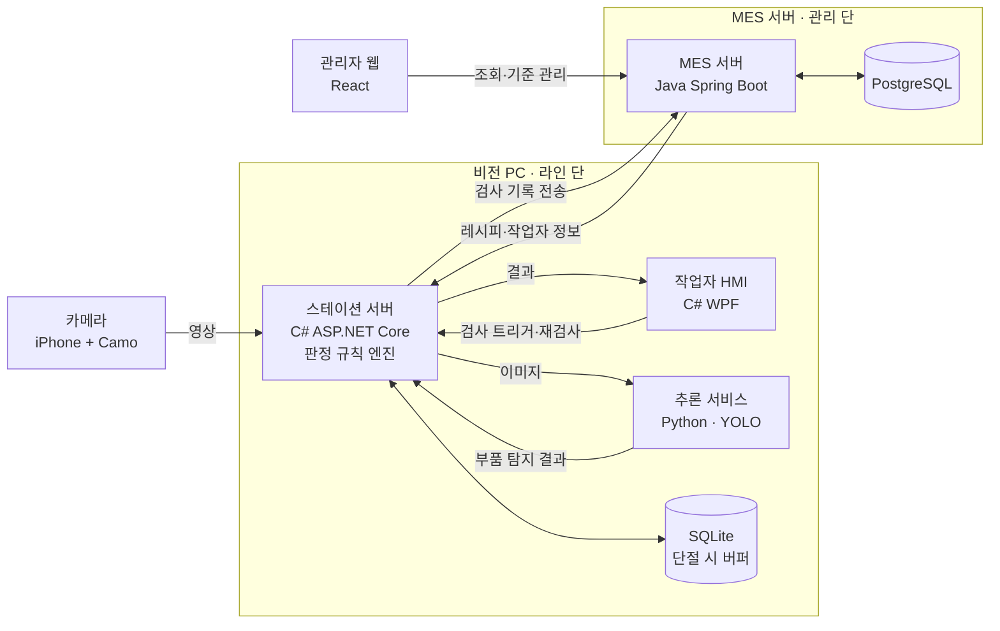
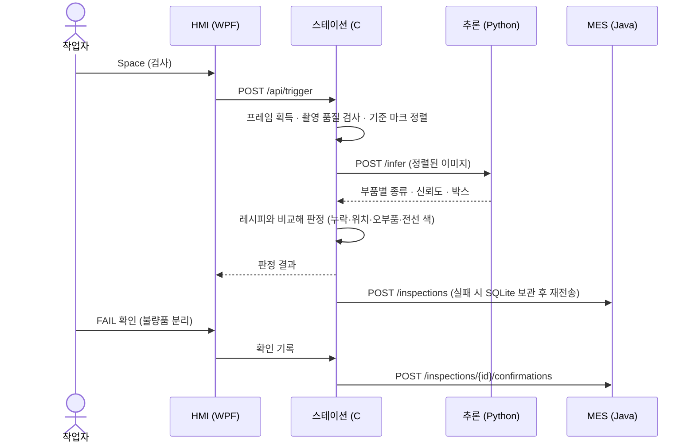
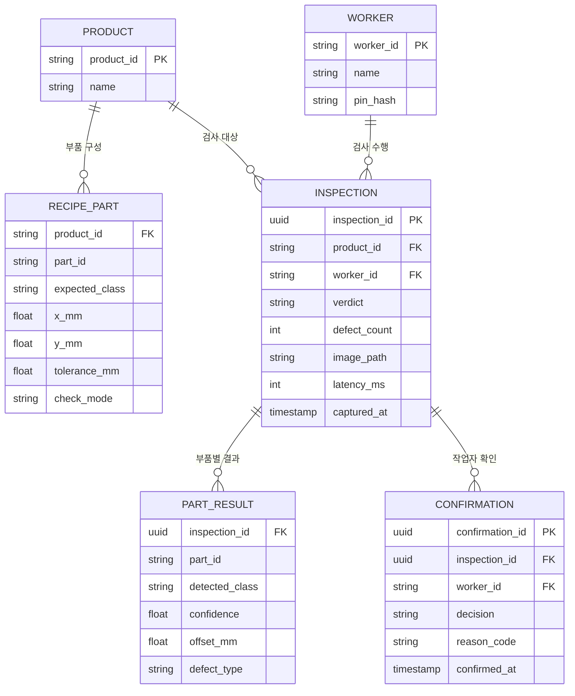

# PCB AOI 검사 스테이션

브레드보드 PCB의 부품 오장착(누락·위치·오부품·전선 색)을 카메라로 검사하고, 결과를 MES에 기록하는 시스템.

## 1. 시스템 구성도



**원칙**
- 판정은 스테이션(C#) 한 곳에서만 한다. 추론 서비스는 탐지 결과만, MES는 기록과 기준만 담당한다.
- DB에 직접 붙는 것은 MES뿐이다. 나머지는 모두 API로 접근한다.
- MES가 끊겨도 검사는 계속된다. 스테이션이 SQLite에 쌓아두고 복구 후 재전송한다.

## 2. 검사 흐름



## 3. 저장소 구조

```
pcb-aoi-station/
├── README.md
├── docs/                         설계 문서
│   ├── api-contract.md           API 계약서
│   └── defect-criteria.md        불량 기준서 (한도 견본 포함)
├── station/                      C# · 조장
│   ├── Inspection.slnx
│   ├── Inspection.Contracts/     HMI와 스테이션이 공유하는 데이터 모델
│   ├── Inspection.Hmi/           작업자 화면 (WPF)
│   └── Inspection.Station/       스테이션 서버 (ASP.NET Core)
├── inference/                    Python · 비전 담당
│   ├── app/                      FastAPI 추론 서비스
│   ├── training/                 학습 스크립트
│   └── requirements.txt
├── mes/                          Java · 백엔드 담당
│   ├── src/main/java/...         Spring Boot
│   ├── src/main/resources/db/    DB 마이그레이션 SQL
│   └── build.gradle
└── web/                          React · 관리자 웹
```

모델 가중치 파일과 촬영 데이터셋은 용량이 커서 Git에 올리지 않는다 (`.gitignore`). 공유 드라이브에 두고 경로만 문서에 적는다.

## 4. 모듈별 정보

| 모듈 | 폴더 | 기술 | 포트 | 담당 |
|---|---|---|---|---|
| 작업자 HMI | `station/Inspection.Hmi` | C# WPF (.NET 10) | — | |
| 스테이션 서버 | `station/Inspection.Station` | C# ASP.NET Core (.NET 10) | 5215 | |
| 추론 서비스 | `inference` | Python, FastAPI, YOLO | 8001 | |
| MES 서버 | `mes` | Java, Spring Boot | 8080 | |
| DB | — | PostgreSQL | 5432 | |
| 관리자 웹 | `web` | React | 5173 | |

## 5. DB 주요 테이블 (MES 소유)



- `inspection_id`는 스테이션이 생성한다. 같은 ID가 재전송되면 MES는 중복 저장하지 않는다.
- 확인 기록은 덮어쓰지 않고 추가만 한다 (감사 추적).
- 이미지는 DB에 넣지 않고 경로만 저장한다.

## 6. 작업 규칙

**브랜치**
- `main`: 항상 실행 가능한 상태. 직접 푸시 금지.
- 작업 브랜치: `모듈/작업내용` (예: `station/hmi-layout`, `mes/inspection-api`, `inference/yolo-train`)
- 작업이 끝나면 PR을 올리고 한 명 이상 확인 후 병합한다.

**충돌 줄이기**
- 각자 자기 폴더 안에서만 작업한다.
- API나 데이터 모양을 바꿀 때는 `docs/api-contract.md`를 먼저 고치고 팀에 알린다.

**커밋 메시지**
- `[station] 검사 결과 화면 추가`, `[mes] 검사 기록 저장 API` 처럼 모듈을 앞에 붙인다.

## 7. 실행 방법

각 모듈 준비가 끝나면 채운다.
