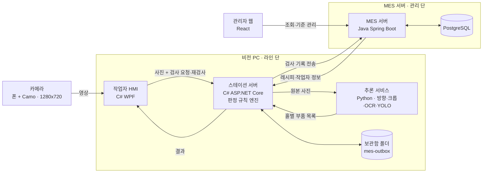
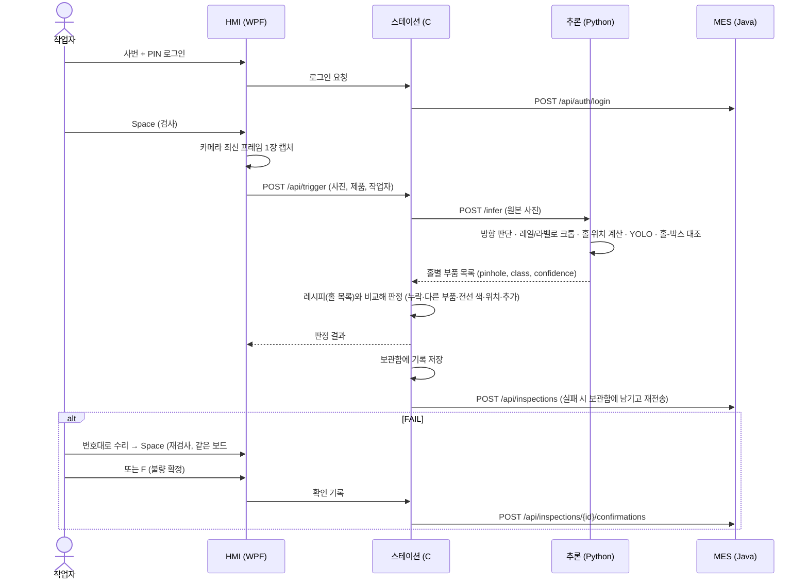
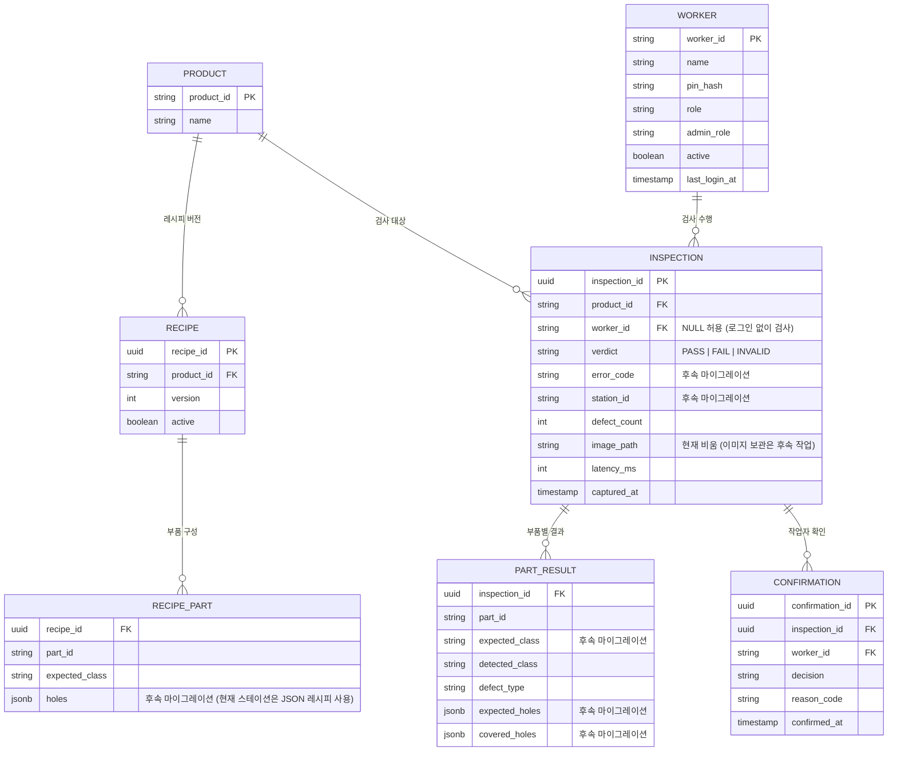

# PCB AOI 검사 스테이션

브레드보드 PCB의 부품 오장착(누락·위치·오부품·전선 색)을 카메라로 검사하고, 결과를 MES에 기록하는 시스템.

## 1. 시스템 구성도



**원칙**
- 판정은 스테이션(C#) 한 곳에서만 한다. 추론 서비스는 탐지 결과만, MES는 기록과 기준만 담당한다.
- DB에 직접 붙는 것은 MES뿐이다. 나머지는 모두 API로 접근한다.
- MES가 끊겨도 검사는 계속된다. 스테이션이 검사 기록을 보관함 폴더(`mes-outbox`, 기록 한 건 = JSON 파일 하나)에 먼저 저장하고, 백그라운드에서 오래된 것부터 MES로 보낸다.
  - SQLite 대신 파일을 쓰는 이유: 비전 PC의 보안 정책(애플리케이션 제어)이 새 네이티브 DLL을 막은 적이 있고(torch), 폴더만 열면 밀린 기록이 보여 확인이 쉽다.
- 사진은 돌리지 않은 원본 그대로 보낸다. 방향은 추론 서비스가 판단한다 (촬영 기준: 보드 번호 10이 화면 위).

## 2. 검사 흐름



**판정 방식 (홀 목록)**
- 보드 좌표는 A~U(보드 번호 10~30, 21행) × 0~13(레일2 + A~E + F~J + 레일2, 14열). 전원 레일에는 E·K·Q 행이 없다.
- 레시피 = 부품마다 "덮어야 할 홀 목록". 정답 보드를 추론에 넣어 나온 결과를 사람이 실제 보드와 대조해 확정한다 (NE555-A v3).
- 판정: 홀이 전부 비었으면 누락 → 종류가 다르면 다른 부품/전선 색 → 일부만 덮였으면 위치 → 레시피 밖에 부품이 있으면 추가. 신뢰도 0.5 미만 탐지는 제외.
- mm 좌표 방식(초기 설계)은 쓰지 않는다. 아래 DB 표의 mm 컬럼은 후속 마이그레이션(번호는 MES 담당이 정함, 현재 V3 사용 중)에서 정리 예정.

## 3. 저장소 구조

```
pcb-aoi-station/
├── README.md
├── docs/                         설계 문서
│   ├── api-contract.md           API 계약서
│   └── defect-criteria.md        불량 기준서 (한도 견본 포함)
├── station/                      C# · 조장
│   ├── Inspection.slnx
│   ├── Inspection.Contracts/     HMI와 스테이션이 공유하는 데이터 모델
│   ├── Inspection.Hmi/           작업자 화면 (WPF)
│   └── Inspection.Station/       스테이션 서버 (ASP.NET Core)
├── inference/                    Python · 비전 담당
│   ├── app/                      FastAPI 추론 서비스
│   ├── training/                 학습 스크립트
│   └── requirements.txt
├── mes/pcb_manage/               Java · 백엔드 담당
│   ├── src/main/java/...         Spring Boot
│   ├── src/main/resources/db/    DB 마이그레이션 SQL
│   └── build.gradle.kts
└── web/                          React · 관리자 웹
```

모델 가중치 파일과 촬영 데이터셋은 용량이 커서 Git에 올리지 않는다 (`.gitignore`). 공유 드라이브에 두고 경로만 문서에 적는다.

## 4. 모듈별 정보

| 모듈 | 폴더 | 기술 | 포트 | 담당 |
|---|---|---|---|---|
| 작업자 HMI | `station/Inspection.Hmi` | C# WPF (.NET 10) | — | |
| 스테이션 서버 | `station/Inspection.Station` | C# ASP.NET Core (.NET 10) | 5215 | |
| 추론 서비스 | `inference` | Python, FastAPI, YOLO | 8001 | |
| MES 서버 | `mes` | Java, Spring Boot | 8080 | |
| DB | — | PostgreSQL | 5432 | |
| 관리자 웹 | `web` | React | 5173 | |

## 5. DB 주요 테이블 (MES 소유)



- `inspection_id`는 스테이션이 생성한다. 같은 ID가 재전송되면 MES는 중복 저장하지 않는다 (409). 요청 형식은 `docs/api-contract.md`의 "검사 기록 API".
- 확인 기록은 덮어쓰지 않고 추가만 한다 (감사 추적).
- 원본 이미지는 MES로 전송하지 않는다. 스테이션도 현재 저장하지 않으며, 이미지 보관은 후속 작업이다.
- `inspection.worker_id`는 NULL을 허용한다 (로그인 없이 검사한 경우).
- 홀 목록(레시피 홀, 탐지 홀)은 JSONB 배열로 저장한다 (예: `["Q9","Q10"]`).
- 레시피는 제품별로 버전을 두고(`RECIPE`), 부품 구성은 버전에 붙는다(`RECIPE_PART`).

## 6. 사용자 인증과 관리

- 사번과 PIN으로 로그인하며 PIN은 BCrypt 해시로만 저장한다.
- 로그인 성공 시 1시간 유효한 HS256 JWT를 발급하고 최근 로그인 시각을 기록한다.
- 관리자 웹 Role은 `ADMIN`, `ENGINEER`, `VIEWER`로 구분한다.
- 사용자 조회·추가·수정·활성화·비활성화·PIN 초기화와 감사 로그 조회는 `ADMIN`만 가능하다.
- 계정이 비활성화되거나 Role이 변경되면 기존 JWT도 다음 요청부터 거부한다.
- 현재 로그인한 관리자와 마지막 활성 관리자는 관리자 권한 해제 또는 비활성화가 불가능하다.
- 로그인과 사용자 변경 이력은 `audit_log`에 기록하며 PIN 원문은 남기지 않는다.

세부 요청·응답 형식은 [API 계약서](docs/api-contract.md)를 참고한다.

## 7. 작업 규칙

**브랜치**
- `main`: 항상 실행 가능한 상태. 직접 푸시 금지.
- 작업 브랜치: `모듈/작업내용` (예: `station/hmi-layout`, `mes/inspection-api`, `inference/yolo-train`)
- 작업이 끝나면 PR을 올리고 한 명 이상 확인 후 병합한다.

**충돌 줄이기**
- 각자 자기 폴더 안에서만 작업한다.
- API나 데이터 모양을 바꿀 때는 `docs/api-contract.md`를 먼저 고치고 팀에 알린다.

**커밋 메시지**
- `[station] MVP-7 검사 결과 화면 추가`, `[mes] MVP-25 검사 기록 저장 API` 처럼 모듈과 Jira 키를 앞에 붙인다 (Jira에 커밋이 자동 연결됨).

## 8. 실행 방법

### MES 서버

Java 17 이상과 PostgreSQL이 필요하다. 기본 접속 정보는 `mes/pcb_manage/src/main/resources/application.properties`에 있으며 운영 환경에서는 `DB_URL`, `DB_USERNAME`, `DB_PASSWORD`, `JWT_SECRET`을 설정한다.

```powershell
cd mes/pcb_manage
.\gradlew.bat bootRun
```

테스트:

```powershell
cd mes/pcb_manage
.\gradlew.bat test
```

### 관리자 웹

Node.js 설치 후 실행한다. API 주소를 지정하지 않으면 `http://localhost:8080/api`를 사용한다.

```powershell
cd web
npm install
npm run dev
```

프로덕션 빌드:

```powershell
cd web
npm run build
```

### 검사 스테이션 (추론·스테이션·HMI)

켜는 순서: **추론 → 스테이션 → HMI** (MES는 따로. 꺼져 있어도 검사는 된다)

**추론 서비스 (8001)** — PowerShell
```powershell
cd <저장소>
Set-ExecutionPolicy -Scope Process -ExecutionPolicy RemoteSigned
.\.venv\Scripts\Activate.ps1
$env:Path += ";C:\Program Files\Tesseract-OCR"
cd inference\app
uvicorn main:app --port 8001
```
- torch는 CPU용이어야 한다 (`pip show torch` → `+cpu`). GPU용은 보안 정책에 막힌다.
- 서버를 켠 뒤 첫 검사는 모델 로딩 때문에 6~7초. 시연 전에 한 번 돌려 둔다.

**스테이션 (5215)**
```powershell
cd station\Inspection.Station
dotnet run
```
- MES 전송은 `appsettings.json`의 `Mes:Enabled`, 주소는 `Mes:BaseUrl`.

**HMI**
```powershell
cd station\Inspection.Hmi
dotnet run
```
- 카메라 번호는 [카메라 전환]으로 찾아 `appsettings.json`의 `Camera:Index`에 기록. 카메라가 없으면 [사진 열기].
- Visual Studio와 dotnet run을 동시에 쓰지 않는다 (실행 중인 프로그램이 파일을 잠가 빌드 실패).

**MES (8080)** — PostgreSQL에 `pcb_aoi` DB 생성 후
```powershell
cd mes\pcb_manage
.\gradlew.bat bootRun
```

**촬영 기준**
- 폰은 탑뷰 스탠드에 고정, 보드 번호 10이 화면 위. 검사 영역(번호 10~30 × 양쪽 레일)이 HMI의 노란 점선을 꽉 채우게.
- Camo 좌우 반전 끄기, 초점·노출 잠금. 연결은 USB 또는 폰 핫스팟.
