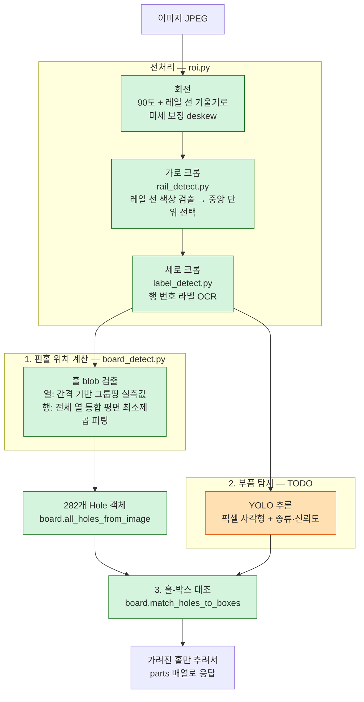

# 추론 서비스 (Python)

- 담당:
- 기술: Python, FastAPI, YOLO
- 포트: 8001

스테이션(C#)이 정렬된 보드 이미지를 보내면, **어느 핀홀에 어떤 부품이 꽂혀 있는지**를
반환한다. 장착 상태가 맞는지 틀린지 "판정"(PASS/FAIL)은 하지 않는다 — 그건 스테이션의 몫이다.
모델 가중치와 데이터셋은 Git에 올리지 않는다.

API 계약(요청/응답 형식)은 [docs/api-contract.md](../docs/api-contract.md) 참고.

## 아키텍처

이미지 한 장이 들어와서 `{pinhole, class, confidence}` 목록이 나가기까지의 전체 흐름.
초록 배경은 완성된 단계, 흰 배경은 아직 TODO인 단계.



## 단계별 설명

### 0. 전처리 — 회전 + 크롭 (`roi.py`, `rail_detect.py`, `label_detect.py`)

카메라가 눕혀서 찍기 때문에 먼저 왼쪽(반시계) 90도로 돌린다. 이후 두 번 더 보정한다:

| 보정 | 방법 | 왜 필요한가 |
|---|---|---|
| **미세 기울기(deskew)** | 선택된 단위의 좌우 경계 레일 선 기울기를 재서(`rail_detect.measure_tilt_angle`) 한 번 더 돌림 | 90도 회전은 큰 방향만 맞출 뿐, 카메라 장착 각도가 정확히 90도가 아니면 -1~+1도 정도 남는다 |
| **가로 크롭** | 빨강/파랑 전원 레일 선을 HSV 색상으로 찾아(`rail_detect.py`), 후보 단위 중 **프레임 중앙에 가장 가까운 것**을 선택 | 고정 픽셀 값은 카메라가 조금만 밀려도(±40px) 못 버틴다. 카메라·지그가 고정이면 검사 대상은 항상 중앙 부근에 있다는 가정 |
| **세로 크롭** | 실크스크린에 인쇄된 행 번호 라벨(10,15,20,25,30)을 **OCR(Tesseract)로 읽어서**(`label_detect.py`) 그 간격으로 계산 | 카메라 위치·줌이 사진마다 미묘하게 달라서, 고정 범위로는 마지막 행(U)이 잘리는 경우가 있었다. 라벨 5개 중 2개 이상 찾으면 선형회귀, 1개만 찾아도 기본 피치로 나머지를 추정 — 폰트가 달라 라벨 하나를 못 읽어도 나머지로 버틴다 |

두 크롭 다 실패하면 각각의 예비 고정값(`FALLBACK_X_RANGE`, `Y_RANGE`)으로 대체된다.

### 1. 핀홀 위치 계산 (`board_detect.py`)

크롭된 이미지 **자체는 변형하지 않고**, 그 안에서 홀(구멍) 282개의 픽셀 위치를 직접 계산한다.

- **열(세로줄) 위치**: 홀 blob들의 x좌표를 간격 기반으로 그룹핑해서 실제 열 14개의 위치를 그대로 쓴다. 단자부 채널 때문에 열 간격이 균등하지 않아서(열 6~7 사이가 특히 넓음), 균등 분할 대신 실측값을 쓴다.
- **행(가로줄) 위치**: 모든 열의 모든 홀을 한꺼번에 모아서 `y = b0 + b1·행번호 + b2·x` 평면 하나를 최소제곱으로 피팅한다. 평면 하나로 모든 위치를 계산하므로 **같은 행(알파벳)은 항상 일직선**이 된다 — 열마다 따로 계산하면 이 보장이 깨진다.
- 레일 열(0,1,12,13)은 E/K/Q 행이 없어서 18칸뿐인데, 물리적 간격은 20칸(건너뛴 자리도 칸 너비를 차지)이라는 점을 반영해서 계산한다.

네 모서리 호모그래피(`calibration.py`, 레거시)나 원근 변환으로 이미지를 평면화하는 방법도 시도했지만, 실측 사진에서 더 부정확하거나 오히려 왜곡을 키우는 걸 확인하고 지금 방식으로 정착했다. 자세한 시행착오는 [WORKLOG.md](WORKLOG.md) 참고.

### 2. 부품 탐지 — TODO (`main.py`의 `detect_parts`)

평탄화(변형)되지 않은 크롭 이미지를 YOLO에 넣어, 부품 종류·신뢰도·픽셀 박스를 얻는다. 모델 로딩·추론 연동이 아직 안 됨.

### 3. 홀-박스 대조 (`board.py`)

"박스 중심과 가장 가까운 핀홀 하나"를 고르는 대신, 반대로 **핀홀마다 어떤 박스 안에 들어가는지**를 본다. 저항처럼 다리(핀) 두 개짜리 부품이 핀홀 두 개에 걸쳐 있어도 둘 다 자연스럽게 잡힌다. 가려진(=장착된) 핀홀만 골라 `{pinhole, class, confidence}` 배열로 응답한다.

## 파일 구성

| 파일 | 역할 | 상태 |
|---|---|---|
| [app/main.py](app/main.py) | FastAPI 앱. `/health`, `/infer` 엔드포인트, 전체 파이프라인 조립 | TODO 1곳 남음 |
| [app/roi.py](app/roi.py) | 회전(90도 + 미세 보정) 후, 가로·세로 크롭 조립 | 완성 |
| [app/rail_detect.py](app/rail_detect.py) | 레일 선 색상 검출로 가로 크롭 범위 + 기울기 측정 | 완성 |
| [app/label_detect.py](app/label_detect.py) | 행 번호 라벨 OCR로 세로 크롭 범위 계산 | 완성 |
| [app/pinhole_grid.py](app/pinhole_grid.py) | 핀홀 282개의 그리드 정의(행 A~U, 열 0~13)와 라벨 변환 | 완성 |
| [app/board_detect.py](app/board_detect.py) | 크롭된 이미지에서 핀홀 282개의 실제 픽셀 위치 계산 | 완성 |
| [app/board.py](app/board.py) | 핀홀을 이미지 속 위치·장착 여부와 함께 구조화, YOLO 박스와 대조 | 완성 |
| [app/calibration.py](app/calibration.py) | (레거시) 네 모서리 호모그래피 방식. 열 간격 비균등 문제로 부정확해서 대체됨 | 레거시 |
| [app/dev_plot_pinholes.py](app/dev_plot_pinholes.py) | 개발용: 크롭 이미지에 핀홀 검출 결과를 그려서 눈으로 확인하는 CLI 스크립트 | 개발 도구 |
| `requirements.txt` | fastapi, uvicorn, python-multipart, pydantic, numpy, opencv-python-headless, pytesseract | — |

실제 사진 4장(부품 없는 보드 1장, 부품 있는 보드 3장)으로 전체 파이프라인이 검증됐다 — 카메라 위치·기울기·조명이 조금씩 다른 사진들에서도 핀홀 위치가 픽셀 단위로 정확히 맞고, IC·LED·커패시터로 홀이 가려져도 정렬이 유지된다.

## 환경 준비

`pytesseract`는 pip 패키지일 뿐이고, 실제 OCR 엔진인 **Tesseract 실행 파일이 별도로 설치**돼 있어야 한다.

```
conda install -c conda-forge tesseract
```

(Windows 설치 프로그램을 써도 된다.) `label_detect.py`가 conda 환경 경로 기준으로 실행파일·언어 데이터 경로를 자동으로 잡아준다.

## 아직 안 된 것 (TODO)

- **`detect_parts`** ([app/main.py](app/main.py)): YOLO 모델 로딩 및 추론 연동. 핀홀 위치 계산은 완성돼 있어서, 이것만 연결하면 `/infer`가 끝까지 동작한다.

세션별 상세 진행 기록(시행착오, 실측 수치, 버그 원인)은 [WORKLOG.md](WORKLOG.md) 참고.
