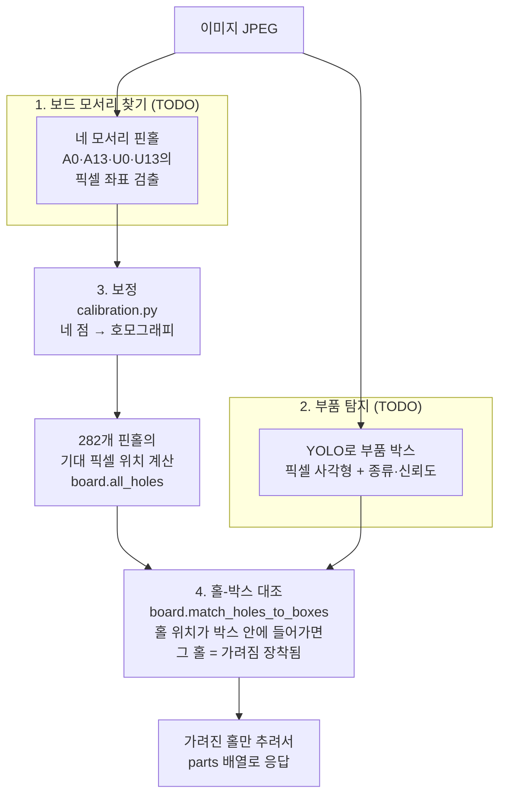

# 추론 서비스 (Python)

- 담당: 
- 기술: Python, FastAPI, YOLO
- 포트: 8001

스테이션(C#)이 정렬된 보드 이미지를 보내면, **어느 핀홀에 어떤 부품이 꽂혀 있는지**를
반환한다. 장착 상태가 맞는지 틀린지 "판정"(PASS/FAIL)은 하지 않는다 — 그건 스테이션의 몫이다.
모델 가중치와 데이터셋은 Git에 올리지 않는다.

API 계약(요청/응답 형식)은 [docs/api-contract.md](../docs/api-contract.md) 참고.

## 처리 흐름

이미지 한 장이 들어와서 `{pinhole, class, confidence}` 목록이 나가기까지, 4단계를 거친다.

**왜 이런 순서인가**
- 촬영마다 보드가 이미지 안에서 조금씩 다르게 나온다(위치·기울기·크기가 미묘하게 다름). 그래서 핀홀 픽셀 위치를 고정값으로 하드코딩할 수 없고, **이미지마다 다시 계산**해야 한다.
- 대신 "보드 전체가 항상 이미지 안에 다 보인다"는 게 보장되어 있으므로, 매번 네 모서리 핀홀(A0·A13·U0·U13)의 픽셀 좌표만 찾으면, 나머지 278개 핀홀 위치는 계산(호모그래피)으로 구할 수 있다.
- "박스 중심과 가장 가까운 핀홀 하나"를 고르는 대신, 반대로 "핀홀마다 어떤 박스 안에 들어가는지"를 본다. 이러면 저항처럼 다리(핀) 두 개짜리 부품이 핀홀 두 개에 걸쳐 있어도 둘 다 자연스럽게 잡힌다.

## 파일 구성

| 파일 | 역할 | 상태 |
|---|---|---|
| [app/main.py](app/main.py) | FastAPI 앱. `/health`, `/infer` 엔드포인트 | 뼈대 완성, TODO 2곳 남음 |
| [app/pinhole_grid.py](app/pinhole_grid.py) | 핀홀 282개의 그리드 정의(행 A~U, 열 0~13)와 라벨 변환 | 완성 |
| [app/calibration.py](app/calibration.py) | 네 모서리 핀홀 픽셀 좌표 → 호모그래피 → 픽셀 ↔ 그리드 좌표 변환 | 완성 |
| [app/board.py](app/board.py) | 핀홀 282개를 이미지 속 위치·장착 여부와 함께 구조화, YOLO 박스와 대조 | 완성 |
| `requirements.txt` | fastapi, uvicorn, python-multipart, pydantic, numpy | — |

## 아직 안 된 것 (TODO)

- **`find_board_corners`** ([app/main.py](app/main.py)): 이미지에서 네 모서리 핀홀(A0·A13·U0·U13)의 픽셀 좌표를 실제로 찾는 부분. 기준 마크가 따로 있는지, 핀홀 자체를 이미지 처리로 찾아야 하는지는 실제 촬영 이미지가 있어야 확인 가능.
- **`detect_parts`** ([app/main.py](app/main.py)): YOLO 모델 로딩 및 추론 연동.

세션별 상세 진행 기록은 [WORKLOG.md](WORKLOG.md) 참고.
